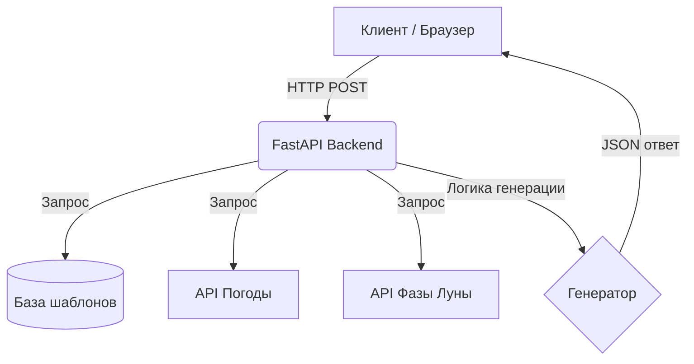

#  Генератор Оправданий (Excuse Generator)

> **Генератор Оправданий** — это веб-приложение, которое генерирует правдоподобные и абсурдные оправдания для любых ситуаций на основе множества факторов: текущей даты, дня недели, фазы луны, погоды и случайных переменных.

##  Возможности
-  Учёт текущей погоды через внешние API.
-  Интеграция с лунным календарём для повышения "абсурдности".
-  Настраиваемый уровень правдоподобности (от "Опоздал на 5 минут" до "Меня похитили инопланетяне").
-  Простой и адаптивный фронтенд.
-  RESTful API для генерации оправданий.

##  Стек технологий
| Компонент | Технология |
| :--- | :--- |
| **Backend** | Python, FastAPI |
| **Frontend** | HTML, CSS, Vanilla JS (или React) |
| **База данных** | SQLite / PostgreSQL |
| **Деплой** | Docker, GitHub Actions |

##  Архитектура (упрощённая)

