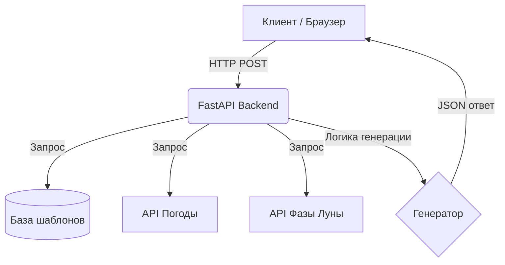

#  Генератор Оправданий (Excuse Generator)

> **Генератор Оправданий** — это веб-приложение, которое генерирует правдоподобные и абсурдные оправдания для любых ситуаций на основе множества факторов: текущей даты, дня недели, фазы луны, погоды и случайных переменных.

---

##  Возможности

-  **Учёт погоды** — интеграция с внешним API для получения актуальных метеоданных.
-  **Лунный календарь** — фаза луны влияет на уровень абсурдности оправдания.
-  **Настраиваемый уровень правдоподобности** — от реалистичного до полностью фантастического.
-  **RESTful API** — возможность интеграции с другими сервисами.

---

## Стек технологий

| Компонент       | Технология                    | Версия   |
| :-------------- | :---------------------------- | :------- |
| **Backend**     | Python, FastAPI               | 3.10+    |
| **Frontend**    | HTML, CSS, Vanilla JS         | ES2022   |
| **База данных** | SQLite / PostgreSQL           | —        |
| **Деплой**      | Docker, GitHub Actions        | —        |
| **Тесты**       | pytest, httpx                 | —        |

---

## Архитектура

Упрощённая схема взаимодействия компонентов системы:

---

##  Быстрый старт

### 1. Клонирование репозитория

    git clone https://github.com/your-username/excuse-generator.git
    cd excuse-generator

### 2. Установка зависимостей

    python -m venv venv
    source venv/bin/activate      # Linux / macOS
    venv\Scripts\activate         # Windows
    pip install -r requirements.txt

### 3. Запуск сервера

    uvicorn main:app --reload

Сервер будет доступен по адресу: **http://localhost:8000**

